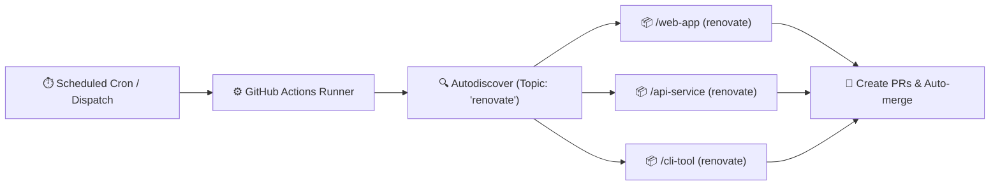

<div align="center">

# 🤖 Renovate Runner 🚀

_Centralized, self-hosted Renovate runner powered by GitHub Actions that dynamically discovers and updates repositories tagged with the `renovate` topic._

[](https://github.com/renovatebot/renovate)
[](LICENSE)
[](#-workflows--automation)

</div>

---

## 💡 Overview

This repository operates a centralized, self-hosted **[Renovate](https://docs.renovatebot.com/)** instance running on **GitHub Actions**.

Instead of running separate Renovate workflows inside every repository or manually maintaining a static repository list, this runner leverages Renovate's native **topic-based autodiscovery** (`autodiscoverTopics`).

Any repository owned by your account or organization that has the **`renovate`** topic applied will automatically be monitored and updated.



### Key Highlights

- **Zero-touch onboarding:** Tag any repo with the `renovate` topic, and Renovate automatically onboards it.
- **Shared config presets:** Host shareable Renovate presets (`default.json` and `automerge.json`) directly from this repository.
- **GitHub App authentication:** Automatically generate short-lived tokens per run, support downstream GitHub Actions triggers on Renovate PRs, and increase GitHub API limits to 15,000 req/hr.
- **Dynamic runner configuration:** Automatically detects your GitHub account/organization and repository name without needing hardcoded values.

---

## 🚀 Onboarding Guide (Fork to Running in 5 Minutes)

Follow these steps to fork this repository and set up automated dependency updates across your GitHub account or organization.

### Step 1: Fork the Repository

1. Click **Fork** at the top right of this repository to create a copy under your personal account or organization.
2. Navigate to the **Actions** tab in your newly forked repository.
3. Click **"I understand my workflows, go ahead and enable them"** (GitHub automatically disables Actions workflows on newly forked repositories).

---

### Step 2: Configure Authentication

Renovate requires GitHub credentials to discover repositories, inspect code, and open pull requests. You can authenticate using either a **GitHub App** (strongly recommended) or a **Personal Access Token (PAT)**.

#### Option A: GitHub App (Recommended)

GitHub Apps provide higher API rate limits (15,000 req/hr), enable downstream GitHub Actions to trigger on Renovate pull requests, and automatically attribute commits to your Renovate bot identity.

You can set this up quickly using the GitHub CLI or manually through the web UI:

<details open>
<summary><b>Fast-Track: Setup with <code>gh</code> CLI</b></summary>

Run the following commands in your terminal (replace `<owner>` and `<repo>` with your GitHub username/org and repository name):

```bash
# 1. Install the GitHub App creation CLI extension
gh extension install kennyg/gh-app-create

# 2. Create the GitHub App with the required permissions
gh app-create \
  --name "<owner>-renovate" \
  --url "https://github.com/<owner>/<repo>" \
  --permissions "contents:write,pull_requests:write,issues:write,workflows:write,metadata:read" \
  --key-out private-key.pem

# 3. Follow the installation link displayed in the output and install on "All repositories"

# 4. Set secrets in your runner repository
gh secret set APP_ID --repo <owner>/<repo> --body "<YOUR_APP_ID>"
gh secret set APP_PRIVATE_KEY --repo <owner>/<repo> < private-key.pem

# 5. Remove the local private key file
rm private-key.pem
```

</details>

<details>
<summary><b>Manual Setup: Via GitHub Web UI</b></summary>

1. **Create the GitHub App:**
   - Go to **[Developer Settings → GitHub Apps → New GitHub App](https://github.com/settings/apps/new)**.
     *(If deploying for an organization, go to `https://github.com/organizations/<your-org>/settings/apps/new`).*
   - Set **GitHub App name:** `<your-org>-renovate` (or your preferred name).
   - Set **Homepage URL:** `https://github.com/<owner>/<repo>`
   - Under **Webhook**: **Uncheck** "Active" (webhooks are not needed).
   - Under **Repository permissions**, grant:
     - `Contents`: **Read & write** *(to push update branches)*
     - `Pull requests`: **Read & write** *(to create and update PRs)*
     - `Issues`: **Read & write** *(to manage the Dependency Dashboard)*
     - `Workflows`: **Read & write** *(to update workflow files in `.github/workflows/`)*
     - `Metadata`: **Read-only** *(selected automatically)*
   - Under **Where can this GitHub App be installed?**, select **Only on this account**.
   - Click **Create GitHub App**.

2. **Generate Private Key & Note App ID:**
   - In the app's settings, copy the numeric **App ID**.
   - Scroll down to the **Private keys** section, click **Generate a private key**, and save the downloaded `.pem` file.

3. **Install the App:**
   - In the left sidebar, click **Install App**.
   - Click **Install** next to your account or organization.
   - Choose **All repositories** (or select specific repositories).
   - Click **Install**.

4. **Add Secrets to Your Runner Repository:**
   - In your forked `renovate` runner repository, go to **Settings → Secrets and variables → Actions**.
   - Add the following repository secrets:

     | Secret Name | Value |
     |---|---|
     | `APP_ID` | Numeric App ID from Step 2 |
     | `APP_PRIVATE_KEY` | Full contents of the downloaded `.pem` file (including `BEGIN`/`END RSA PRIVATE KEY` lines) |

</details>

---

#### Option B: Personal Access Token (PAT)

If you prefer using a Personal Access Token instead of a GitHub App:

1. Generate a Fine-grained PAT or Classic PAT with `repo` and `workflow` scopes.
2. In your runner repository, go to **Settings → Secrets and variables → Actions**.
3. Add a secret named `RENOVATE_TOKEN` (or `APP_TOKEN`) containing your token.

> [!NOTE]
> Pull requests created by a PAT with default permissions will not trigger downstream GitHub Actions workflows unless configured with specific credentials. A GitHub App is recommended to ensure your CI workflows run on Renovate PRs.

---

### Step 3: Tag Your Repositories

Any repository owned by your account/org that has the **`renovate`** topic applied will automatically be picked up by Renovate:

1. Navigate to any target repository you want Renovate to manage.
2. In the **About** section (top right of the repository homepage), click the ⚙️ gear icon.
3. Under **Topics**, add:
   ```
   renovate
   ```
4. Click **Save changes**.

Alternatively, tag repositories using the GitHub CLI:

```bash
gh repo edit <owner>/<target-repo> --add-topic renovate
```

---

### Step 4: Run Renovate & Verify

Run a dry-run test to verify that authentication works and your tagged repositories are discovered:

#### Via GitHub CLI:
```bash
# Trigger a full dry-run test
gh workflow run renovate.yaml --repo <owner>/<repo> -f dry_run=full

# Watch the run output
gh run watch --repo <owner>/<repo>
```

#### Via GitHub Web UI:
1. Go to the **Actions** tab in your runner repository.
2. Select the **renovate** workflow on the left.
3. Click **Run workflow**, choose `dry_run: full`, and click **Run workflow**.
4. Check the workflow run logs to verify Renovate discovered your tagged repositories.

Once the dry run succeeds, trigger the workflow with `dry_run: null` (default) or wait for the automatic scheduled run. Renovate will open a **`👷 configure renovate`** onboarding pull request on each discovered repository!

---

## 📦 Shared Configuration Presets

This repository serves as a **Shareable Config Preset** host. Repositories can reference these presets directly in their `.renovaterc.json5` or `renovate.json`:

```json5
{
  $schema: "https://docs.renovatebot.com/renovate-schema.json",
  extends: [
    "github><owner>/<repo>",
    "github><owner>/<repo>:automerge",
  ],
}
```

### 1. Default Preset (`default.json`)

**Reference:** `"extends": ["github><owner>/<repo>"]`

Features:
- Extends `config:recommended`, `docker:enableMajor`, and `helpers:pinGitHubActionDigests`.
- Enables the Dependency Dashboard (`Renovate Dashboard 🤖`).
- Uses Gitmoji commits by default (via [`gitmoji.json`](gitmoji.json)).
- Structured PR labels (`renovate/container`, `renovate/github-action`, `renovate/helm`, `renovate/mise`, `renovate/pre-commit`, `renovate/python`, etc.).
- Custom regex managers to detect dependencies annotated with `# renovate: datasource=... depName=...`.
- Support for `oci://` image strings.

### 2. Gitmoji Preset (`gitmoji.json`)

**Reference:** `"extends": ["github><owner>/<repo>:gitmoji"]`

Features:
- Semantic commits formatted with [Gitmoji](https://gitmoji.dev/):
  - 💥 `major` updates (`semanticCommitType: "💥 "`)
  - ✨ `minor` updates (`semanticCommitType: "✨ "`)
  - 🐛 `patch` updates (`semanticCommitType: "🐛 "`)
  - 📌 `digest` and `pin` updates (`semanticCommitType: "📌 "`)
  - 👷 GitHub Actions updates (`semanticCommitType: "👷 "`, scope: `github-action`)
  - 🔒 Lockfile maintenance (`semanticCommitType: "🔒 "`)
- Formatted version tags `( {{currentVersion}} → {{newVersion}} )` and labels (`type/major`, `type/minor`, `type/patch`, `type/digest`).

### 3. Conventional Commits Preset (`conventional.json`)

**Reference:** `"extends": ["github><owner>/<repo>:conventional"]`

Features:
- Standard [Conventional Commits](https://www.conventionalcommits.org/) (no emojis):
  - `feat` for `major` and `minor` updates (`semanticCommitType: "feat"`)
  - `fix` for `patch` updates (`semanticCommitType: "fix"`)
  - `chore` for `digest`, `pin`, and `lockFileMaintenance` (`semanticCommitType: "chore"`)
  - `ci` for GitHub Actions (`semanticCommitType: "ci"`, scope: `github-action`)
- Formatted version tags `( {{currentVersion}} → {{newVersion}} )` and standard type labels.

### 4. Safe Auto-merge Preset (`automerge.json`)

**Reference:** `"extends": ["github><owner>/<repo>:automerge"]`

Features:
- Automatically merges non-breaking (`minor`, `patch`, `digest`) updates for:
  - GitHub Actions
  - Pre-commit hooks
  - Mise tool configurations
- Requires a **3-day stability period** (`minimumReleaseAge: "3 days"`) and passing CI tests before merging.

### Example Configurations for Target Repositories

<details open>
<summary><b>Example A: Using Gitmoji Commits</b></summary>

```json5
{
  $schema: "https://docs.renovatebot.com/renovate-schema.json",
  extends: [
    "github><owner>/<repo>",
    "github><owner>/<repo>:automerge",
  ],
}
```

</details>

<details>
<summary><b>Example B: Using Conventional Commits (No Emojis)</b></summary>

```json5
{
  $schema: "https://docs.renovatebot.com/renovate-schema.json",
  extends: [
    "github><owner>/<repo>",
    "github><owner>/<repo>:conventional",
    "github><owner>/<repo>:automerge",
  ],
}
```

</details>

### Customizing Presets

To adapt the presets to your team's conventions:
- Edit [`default.json`](default.json) to adjust base managers or labels.
- Edit [`gitmoji.json`](gitmoji.json) or [`conventional.json`](conventional.json) to adjust commit prefixes and types.
- Edit [`automerge.json`](automerge.json) to tweak stability periods or add managers for automated merging.
- Any repository extending `"github><owner>/<repo>"` will automatically adopt your updated presets on subsequent runs.

---

## ⚙️ Configuration & Customization Options

### Repository Variables (`vars`)

Configure these under **Settings → Secrets and variables → Actions → Variables**:

| Variable | Description | Default |
|---|---|---|
| `RENOVATE_AUTODISCOVER_FILTER` | JSON array or pattern filtering discovered repositories | `["<github.repository_owner>/*"]` |
| `RENOVATE_AUTODISCOVER_TOPICS` | JSON array or topic string for target repositories | `["renovate"]` |
| `RENOVATE_CONFIG_PRESET` | Preset used in onboarding pull requests | `github><owner>/<repo>` |
| `RENOVATE_ONBOARDING_CONFIG_FILE_NAME` | Configuration file name created in onboarded repositories | `renovate.json` |

> [!TIP]
> **Prettier & Pre-commit Compatibility**: The runner automatically formats onboarding configuration files (`renovate.json`) to adhere to Prettier's single-line array conventions so that CI checks and pre-commit hooks pass without modification. If you prefer using `.renovaterc.json5` or another file format for onboarding, set `RENOVATE_ONBOARDING_CONFIG_FILE_NAME` in repository variables.

### Repository Secrets (`secrets`)

Configure these under **Settings → Secrets and variables → Actions → Secrets**:

| Secret | Description | Required |
|---|---|---|
| `APP_ID` (or `RENOVATE_APP_ID`) | GitHub App ID | Recommended |
| `APP_PRIVATE_KEY` (or `RENOVATE_APP_PRIVATE_KEY`) | GitHub App RSA Private Key (`.pem`) | Recommended |
| `APP_TOKEN` / `RENOVATE_TOKEN` | Alternative Personal Access Token or external installation token | Optional |
| `DOCKER_USERNAME` / `DOCKER_TOKEN` | Docker Hub credentials to avoid Docker rate limits | Optional |

---

## 🚀 Workflows & Automation

### Automated Schedules & Triggers

The runner workflow (`.github/workflows/renovate.yaml`) runs:
- **On Schedule:** Every 30 minutes (`0/30 * * * *`).
- **On Push:** When updates are merged into `main` affecting runner configurations or presets.
- **Manual Dispatch:** On demand via GitHub Actions UI or `gh workflow run`.

### Manual Workflow Dispatch Options

| Input | Description | Default | Allowed Values |
|---|---|---|---|
| `repository` | Target a specific repo (e.g. `owner/repo`). Leave blank to discover all topic-tagged repos. | `""` | Any `owner/repo` string |
| `dry_run` | Test Renovate without opening or updating PRs | `null` | `null`, `extract`, `lookup`, `full` |
| `log_level` | Adjust logging verbosity | `info` | `trace`, `debug`, `info`, `warn`, `error` |
| `repo_cache` | Control repository cache reuse | `enabled` | `enabled`, `disabled`, `reset` |

---

## 🛠️ Repository Architecture

```
renovate/
├── .github/
│   ├── renovate-config.js      # Global Renovate runner configuration
│   └── workflows/
│       ├── renovate.yaml       # Main runner workflow (cron, push, manual dispatch)
│       └── validate.yaml       # CI validation (renovate-config-validator & actionlint)
├── default.json                # Shareable default preset ("github><owner>/<repo>")
├── gitmoji.json                # Shareable Gitmoji preset ("github><owner>/<repo>:gitmoji")
├── conventional.json           # Shareable Conventional Commits preset ("github><owner>/<repo>:conventional")
├── automerge.json              # Shareable automerge preset ("github><owner>/<repo>:automerge")
├── .renovaterc.json5           # Runner repo's self-renovating configuration
├── .pre-commit-config.yaml     # Pre-commit hooks for repo formatting and linting
└── LICENSE                     # MIT License
```

---

## 📄 License

This project is licensed under the [MIT License](LICENSE).
