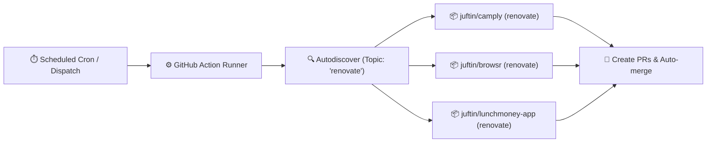

<div align="center">

# 🤖 renovate 🚀

_Self-hosted Renovate runner powered by GitHub Actions that dynamically discovers and updates repositories tagged with the `renovate` topic._

[](https://github.com/juftin/renovate/actions/workflows/renovate.yaml)
[](https://github.com/juftin/renovate/actions/workflows/validate.yaml)
[](https://github.com/renovatebot/renovate)
[](https://opensource.org/licenses/MIT)

</div>

---

## 💡 Overview

This repository operates a centralized, self-hosted **[Renovate](https://docs.renovatebot.com/)** instance running on **GitHub Actions**.

Instead of running separate Renovate workflows inside every repository or manually maintaining a static repository list, this runner leverages Renovate's native **topic-based autodiscovery** (`autodiscoverTopics`).

Any repository owned by your account that has the **`renovate`** topic applied will automatically be monitored and updated.



---

## 🎯 How to Enable Renovate on a Repo

Enabling Renovate for any of your repositories takes just **one step**:

1. Navigate to the target repository on GitHub.
2. In the repository **About** section (top right of the repo page), click the ⚙️ gear icon.
3. Under **Topics**, add:
   ```
   renovate
   ```
4. Save changes.

On the next scheduled run (or via manual `workflow_dispatch`), Renovate will automatically discover the repository and create an onboarding pull request using the default shared presets.

---

## 📦 Shared Configuration Presets

This repository doubles as a **Shareable Config Preset** host. Repositories can reference these presets directly in their own `.renovaterc.json5` or `renovate.json`:

### 1. Default Preset (`default.json`)

Reference: `"extends": ["github>juftin/renovate"]`

Features:
- Extends `config:recommended`, `docker:enableMajor`, `helpers:pinGitHubActionDigests`.
- Enables Dependency Dashboard (`Renovate Dashboard 🤖`).
- Semantic commits with emoji prefixes:
  - 💥 `major`
  - ✨ `minor`
  - 🐛 `patch`
  - 📌 `digest`
- Categorized PR labels (`renovate/container`, `renovate/github-action`, `renovate/helm`, `renovate/python`, etc.).
- Custom regex managers to detect dependencies annotated with `# renovate: datasource=... depName=...`.
- Support for `oci://` image strings.

### 2. Safe Auto-merge Preset (`automerge.json`)

Reference: `"extends": ["github>juftin/renovate:automerge"]`

Features:
- Automatically merges non-breaking (`minor`, `patch`, `digest`) updates for GitHub Actions, pre-commit hooks, and Mise tools after a **3-day stability period**, provided all tests pass.

### Example Target Repo Config (`.renovaterc.json5`):

```json5
{
  $schema: "https://docs.renovatebot.com/renovate-schema.json",
  extends: [
    "github>juftin/renovate",
    "github>juftin/renovate:automerge",
  ],
}
```

---

## 🔐 Authentication Setup

Renovate requires authentication to scan repositories and open pull requests. You can configure either a **GitHub App** (recommended) or a **Personal Access Token (PAT)**.

### Option A: GitHub App (Recommended)

GitHub Apps have higher API rate limits (15,000 req/hr), and pull requests opened by a GitHub App automatically trigger downstream GitHub Actions CI workflows. Additionally, Renovate automatically detects and attributes commits to your GitHub App bot user.

You can provide either:
- **App Credentials (Generated at runtime):**
  - `RENOVATE_APP_ID` (or `APP_ID`)
  - `RENOVATE_APP_PRIVATE_KEY` (or `APP_PRIVATE_KEY`)
  - The workflow automatically mints a short-lived installation token using `actions/create-github-app-token`.
- **Pre-generated App Installation Token:**
  - `APP_TOKEN`: If you already generate or manage an installation token.

**GitHub App Permissions Required:**
- `Contents`: Read & write
- `Pull requests`: Read & write
- `Issues`: Read & write
- `Workflows`: Read & write
- `Metadata`: Read-only

### Option B: Personal Access Token (PAT)

- `RENOVATE_TOKEN`: Personal Access Token with `repo` and `workflow` scopes.

### Optional Secrets:
- `DOCKER_USERNAME` / `DOCKER_TOKEN`: Docker Hub credentials to avoid Docker pull rate limits.

---

## 🚀 Manual Workflow Dispatch & Dry Runs

The workflow can be triggered manually from the GitHub Actions tab with customizable options:

| Input | Description | Default | Options |
|---|---|---|---|
| `repository` | Target a specific repo (e.g. `juftin/camply`). Leave empty for topic autodiscovery. | `""` | Any `owner/repo` string |
| `dry_run` | Test Renovate without creating or modifying PRs | `null` | `null`, `extract`, `lookup`, `full` |
| `log_level` | Adjust output verbosity | `info` | `trace`, `debug`, `info`, `warn`, `error` |
| `repo_cache` | Control repository cache | `enabled` | `enabled`, `disabled`, `reset` |

---

## 🛠️ Repository Architecture

```
renovate/
├── .github/
│   ├── renovate-config.js      # Global self-hosted Renovate configuration
│   └── workflows/
│       ├── renovate.yaml       # Main runner workflow (cron, push, dispatch)
│       └── validate.yaml       # CI validation (renovate-config-validator & actionlint)
├── default.json                # Shared preset ("github>juftin/renovate")
├── automerge.json              # Shared automerge preset ("github>juftin/renovate:automerge")
├── .renovaterc.json5           # Repo's self-renovating configuration
├── .pre-commit-config.yaml     # Pre-commit hooks (yamlfmt, check-yaml, etc.)
└── LICENSE                     # MIT License
```

---

## 📄 License

This project is licensed under the [MIT License](LICENSE).
